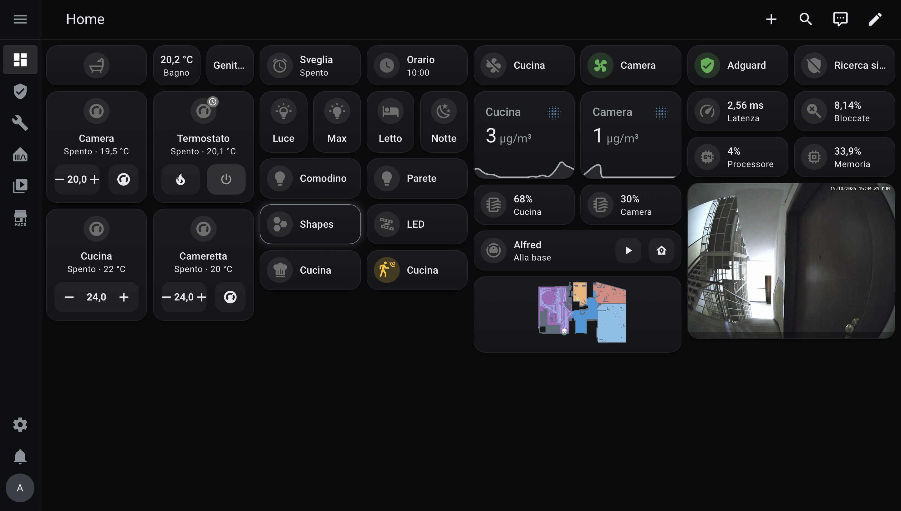

# Dark Moon Theme

A minimal dark theme for Home Assistant with: graphite cards, cool silver accents and a soft silver glow on hover.



## Features

- Near-black background with graphite cards and a subtle top-to-bottom gradient
- Thin neutral borders and a tight shadow that never spills onto neighbouring cards
- Silver border and glow on hover (mouse only, never stuck on touch screens)
- Readable text fields, dropdowns, dialogs, switches and sliders
- Works great with [Mushroom](https://github.com/piitaya/lovelace-mushroom) cards
- Does not change font sizes, icon sizes, spacing or your cards' icon colors

## Requirements

- [card-mod](https://github.com/thomasloven/lovelace-card-mod) is **recommended**, not required.
  - With card-mod: graphite gradient on cards and silver hover effect.
  - Without card-mod: everything else works; cards are a flat `#17181b` and there is no hover effect.

## Installation

### HACS (recommended)

[](https://my.home-assistant.io/redirect/hacs_repository/?owner=RazerPC&repository=Dark-Moon&category=theme)

1. Open HACS and search for **Dark Moon Theme**, or click the button above.
2. Download it.
3. Use **Quick reload** (Settings → System → Restart Home Assistant) to load the theme.

### Manual

1. Copy `themes/dark_moon.yaml` into your `config/themes/` folder.
2. Use **Quick reload** (Settings → System → Restart Home Assistant) to load the theme.

In both cases, `configuration.yaml` must load themes:

```yaml
frontend:
  themes: !include_dir_merge_named themes
```

## Usage

1. Open your **Profile**.
2. Under **Theme**, choose **Dark Moon**.
3. Set the mode to **Dark**.

Dark Moon only has a dark variant. If the mode is set to Auto and your device is in light mode, Home Assistant mixes in its own light colors and some text becomes hard to read.

## Customization

Edit `themes/dark_moon.yaml` (colors, border radius, hover glow); every value is commented.

To use your own color on a single card (requires card-mod):

```yaml
card_mod:
  style: |
    ha-card {
      --dark-moon-card-gradient: none;
      --ha-card-background: #2b1d0e;
    }
```

## License

MIT
